# anteikuHUD — feature overview

**HUD statistics for Broken Ranks**: an overlay on top of the game that shows farming statistics, expenses, profit, goals and events in real time. All data is stored locally in an SQLite database — history accumulates between launches.

[Русский](README.md) · **English** · [Polski](README.pl.md)

---

## 1. Capture and game connection

- **Network packet capture** via Npcap — the program sees game events in real time (fights, loot, gold, experience, etc.). Nothing is injected into the game, no packets are sent and the client is not modified.
- **Capture device selection** (menu "Capture device…") — if traffic goes through VPN or another network adapter, you can point it to the right one; VPN adapters are marked with a badge in the list.
- **Switching capture device** — the program restarts correctly.
- Packet capture requires running **as administrator** (mandatory on first launch).

## 2. Main HUD window

The HUD consists of **two windows**: a header with the quick-launch panel and a separate tiles window with statistics. When collapsed, only the header is visible; hovering over it expands the tiles instantly, without delay. Dragging by the tiles moves the whole HUD together with the header.

- **Live session and fight statistics** — shards, psycho experience, gold, essences.
- **HUD rows** (order is configurable): Session, Inst., Gold, Profit, Expenses, Instances, Exp, Psycho, Rating, Streak, Rar. Profit, Expenses, Streak and Rar have their own windows and compact mini versions in the HUD strip.
- **Quick-launch panel** in the header: Storage, Champions, Chats, Market — open the corresponding windows with one click.
- **Placement modes:**
  - **normal** — header on top, tiles below it;
  - **"Header at the bottom (mirrored)"** — the header is pinned to the bottom, content unfolds upwards, and windows are stacked above the HUD;
  - **"HUD strip at the screen edge"** — a narrow strip at the left or right edge of the screen: 38 px when collapsed, expands to 232 px on hover with a mini-dock of icons and values. The strip and the mirrored mode are mutually exclusive.
- **Follow the game window** — the HUD (and the strip) sticks to the game window instead of the monitor edge; one setting covers both modes.
- **Display and hiding** — the "Bind display to the game" checkbox and the list of HUD windows: when the game is minimised or not focused, the checked windows are hidden while the rest stay on screen. By default Market, Storage, Assembly, Chat and the Phase lamp collapse with the game; each window has its own "Collapse" checkbox and changes are saved immediately.
- **HUD settings:** auto-hide, HUD scale, header, tile and tiles-window opacity, strip backdrops (0% — solid black, 100% — fully transparent), section order, fonts and colours.
- **Hotkeys:**
  - `Ctrl+F2` — hide/show HUD;
  - `Ctrl+F3` — event timer display mode: all circles or only those starting within 15 minutes.

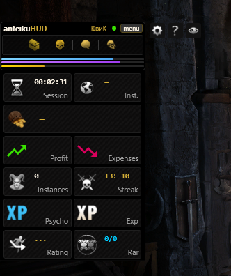

## 3. Profit, expenses and market

- **"Profit" window** — what was taken out of instances during the session. The header shows "Total shards" and "Total essences". Categories are shown as tabs, and a tab appears only when it has something in it: Rares, Sets, Epics, Synergetics, Drifs, Orbs, Items.
  - Each tab header shows the number of positions and the shard/essence total for the category.
  - All positions are shown as tiles with icons; identical synergetics are merged with their quantity, and the inhibitor is counted per item.
  - The **auction gavel** on a tile, in the group header and in the window header opens the market card: price per piece and total, in gold and platinum, in shards and essences, with and without the inhibitor. If there are no prices, the hint says "no prices — open the trade".
  - The selected tab is remembered.
- **"Expenses" row** — session spending (purchases, entry fees, NPC operations); the row has its own window with a breakdown by position.
- **"Market" window** — fresh prices that the HUD records passively from the in-game trade. The program does not request packets: every new observation replaces the old data for its area.
  - The header has six currency buttons: 10 Platinum Box, 50 Platinum Box, Essence, Shard, Reol, Dvigg. Each shows the price and the ▲/▼ percentage change; the tooltip lists the last 7 price changes.
  - Tabs "All", "Items", "Drifs", "Orbs"; empty tabs are hidden.
  - Search by name, tiles 7×3 and pagination of 21 positions.
  - Clicking a tile opens the card: gold and platinum (gold has priority), drifs are counted in essences and orbs in shards; values are shown with and without the inhibitor. Close with `Esc` or a click outside the card.
  - When a currency rate changes, a "was → now" notification pops up.
  - Market prices are **for reference**: profit is still calculated from actual deals.

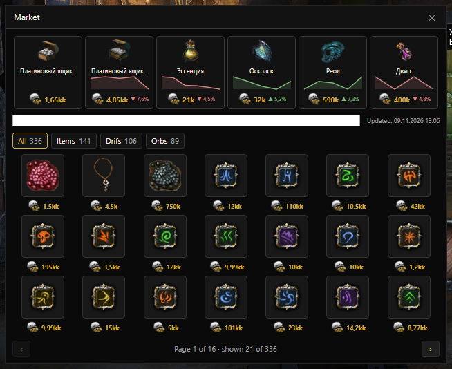

## 4. Statistics windows

Windows with period filters: **today, 24 hours, 7/30 days, game week** (starts Monday 00:00) and **game month** (starts the 1st at 00:00) — by Polish (server) time, plus character and tier filters.

- **Statistics** — tabs "Rares", "Orbs", "Tier streaks" and "Bosses". Tables show date, item, ornament (sortable), percentage and player; favorites can be marked with a star right in the statistics.
- **No-rare streaks per boss** — five permanent tabs T1–T4 and S. Each table reads "Boss · Current · Average · 1 · 2 · 3 · 4 · 5"; the order follows the last fight and the current boss is highlighted. If a tier has no bosses yet, the tab says "No bosses encountered". The selected tab is remembered and does not reset on live updates.
- **Analytics** — instance statistics. Tabs:
  - **Summary** — overall instance statistics (time, experience, psycho, rares, sets, synergetics, orbs, drifs, gold, shards and essences with the inhibitor, income per minute);
  - **Runs** — what dropped and from where, per instance;
  - **Totals** — loot for time periods, plus "Boss fees" and "Expenses";
  - **By item** — drop history of a selected item, per-instance statistics, the best instance to farm, quantity and inhibitor, expenses and income per run and per hour;
  - **Arena** — runs, expenses by level and deaths.

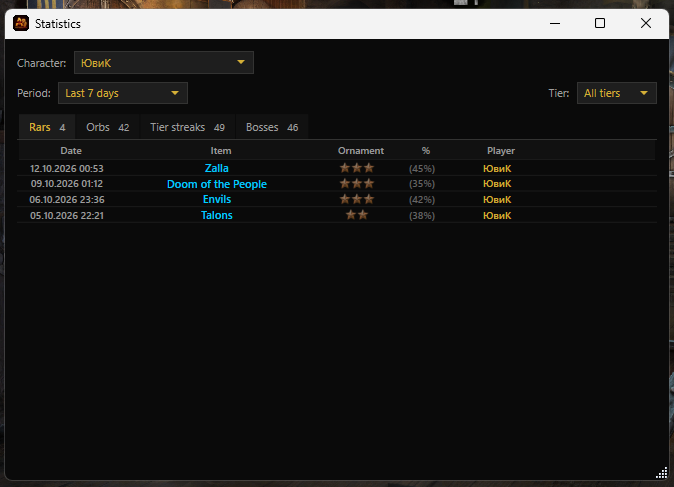

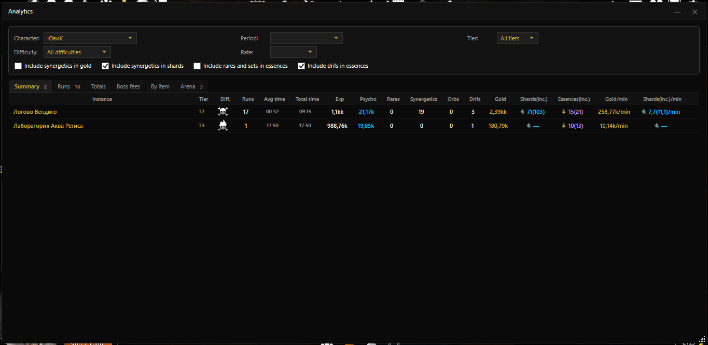

## 5. Goals and progress

- **Goal progress bars** — a separate window with a bar for each goal.
- **Live goal: desired item set** — set a list of items and the HUD will hint what has already dropped/collected; item selection via a picker window.
- **Goal ETA** — estimated time to reach the goal; for limited locations — a calendar deadline; respects the rare chance cap.
- Goals can be set for shards, psycho, gold, item sets and the event counter (the counter counts mob packs and is calibrated with three packs per character).
- **Goal sounds** — gold, psycho, shards, item set and event counter are configured in the "Sounds" window.

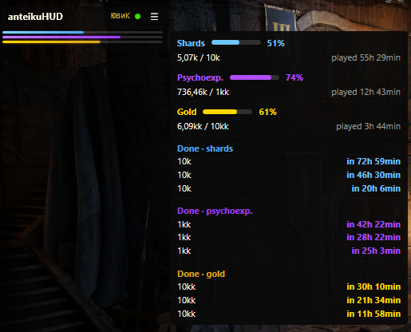

## 6. Deposit and backpack

- **Chest viewer** — contents of all chests in the Deposit with icons (refreshed when you enter the Deposit in game, each chest separately).
- **"All deposits" view** — a common list with an "All" highlight.
- **Tiles** of items with icons (equipment — from packet fields), chest number in the tile corner, bound orb icons, number under the chest number.
- **Filters and categories** — search (including without apostrophes), "Bound" checkbox, golden border for the selection, gold and platinum icons.
- **"Backpack" tab** — the character's backpack contents: updated from the game, the last known state is kept in the database, and the tile carries an "R" badge.
- Contents are updated only for the tabs you have opened in the game; nothing disappears by itself. Each tab has a "Clear" button, and if there is no data yet the hint says "Open the deposit in game — contents will be recorded automatically".
- Items outside combat are shown as well ("+N" icon for incoming items).

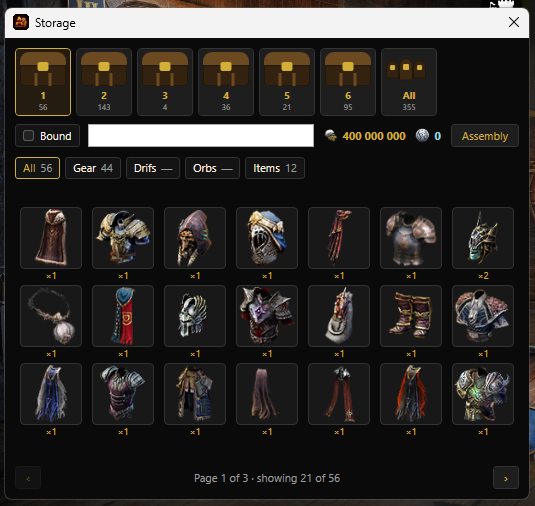

## 7. Assembly

- **"Assembly" window** — what can already be combined from chest contents (drifs, orbs, synergistics) by the game rules: drifs compared by size, orbs grouped by level category, synergistics summarized by rank.
- **Tile view** with names from the packet, page-by-page switching.
- "Synergetics" tab — composition info by ranks.

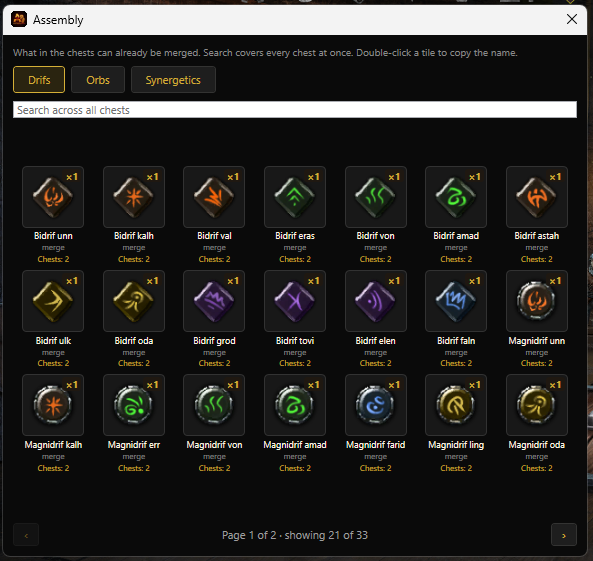

## 8. Favorites and notifications

- **Favorites** — mark valuable items, orbs and drifs, equipment for visual notification when looted.
- **Popup notifications** — loot/expense icons appear to the right of the HUD header on a transparent background. Icon size, background opacity, display time, coloured border, hover highlight and showing the name on hover are configurable.
- **Price change notifications** — when a market currency rate changes, a "was → now" message pops up.

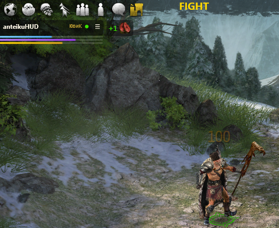

## 9. Champion tracking (respawn tracker)

- **Champion catalogue** — every Broken Ranks champion with its respawn time, grouped by
  location; the window has four tabs: **"Running"**, **"Favorites"**, **"All"** and **"Autofix"**.
- **Respawn timers** — click a tile to start a countdown to the champion's respawn. The
  countdown uses the time from the catalogue (for champions with a range — the minimum).
- **"Running" tab** — only live timers: both those still counting down to respawn and those
  whose respawn has already happened (the green window). The list updates itself as time passes.
- **Green respawn window** — when the countdown hits zero, the tile switches to a green
  "RESPAWN M:SS" counter: the respawn is already possible and lasts that long (the difference
  between the minimum and maximum time). When the window closes, the timer resets.
- **"Respawn soon" warning** — 5 minutes before the champion respawns.
- **Badges in the notification bar by the HUD** — champion readiness is shown as an icon next
  to the main window; clicking the badge opens the tracker window.
- **Favorites** — the ★ star on a tile adds the champion to favorites; when such a champion is
  killed, a "Start timer?" bubble pops up — the timer starts with a single click.
- **Autofix** — the "A" button on a tile adds the champion to autofix (mutually exclusive with ★).
  When such a champion is killed, the timer starts by itself, without a bubble. The tab is
  available in all builds, including the release one.
- **Name filter** — the "Filter by champion name…" field; `Esc` clears the filter.
- **Doubled champions** — Tomb and Nixoflower live in a location as two copies: each gets two
  tiles with separate timers.
- **Tile tooltip** — the respawn time and a hint of how long the champion stays before vanishing.
- **Multiple monitors** — timers and badges work correctly at any HUD position.

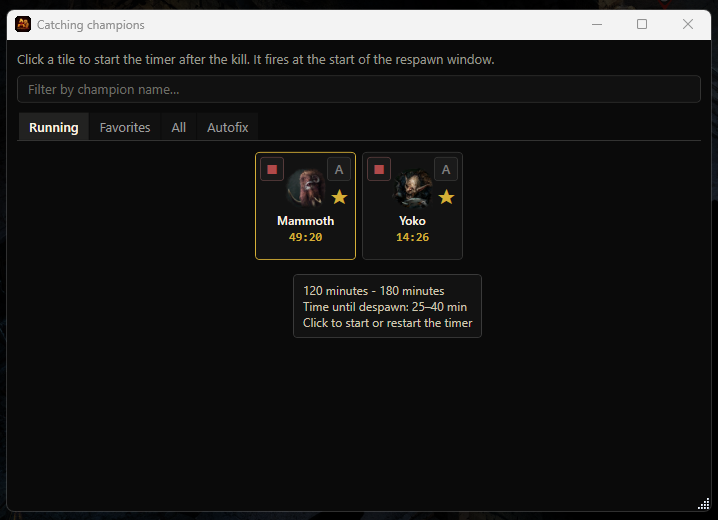

## 10. Chat

- **In-game chat tracking** — the "Chats" window (menu "Chats") records game messages in
  real time, searches for keywords and shows notifications.
- **Main switch** — "Record and process chat"; the chat is **off** by default. While the
  checkbox is off, messages are not saved, not checked for trigger words and produce no
  notifications. The state is remembered between launches.
- **Message log** — table "Time · Nick · Message", newest on top; your nick mention is
  highlighted in gold, a fired trigger in orange. Auto-scroll, search by nick/text,
  right-click copy (nick / message / all), clear the file and open the log in an editor.
- **Character filter** — show only checked characters; **ignore** — hide the selected ones
  from the log and mute their notifications (messages are still written to the file).
- **Trigger words** — a list of keywords that pop up a notification: add, edit in place
  (double-click), delete and an **enable/disable checkbox** — unchecked temporarily turns
  the search off, the word stays in the list and is dimmed.
- **Fuzzy search** — catches inflections and typos: the first letter must match, an exact
  match from the start of the word, otherwise 1–2 typos are allowed (words shorter than
  4 letters — exact only; triggers not starting with a letter — exact match). A word
  combination fires when all words are present in any order.
- **Notifications** — a popup toast in the bottom-right corner (7 seconds) and a sticky
  unread badge with a counter in the notification bar until the "Chats" window is opened.
- **Log file** — `chat_log.txt` next to the program, UTF-8 without BOM; the last 3000
  messages are kept in memory, all of them in the file ("Full history" checkbox reads the
  file for all days).
- **Localization** — Russian, English, Polish.

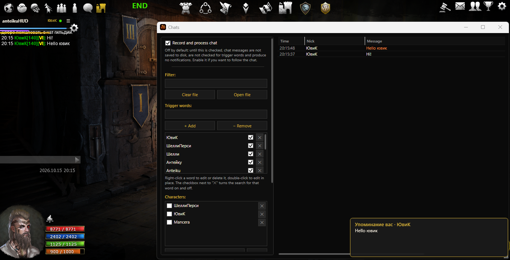

## 11. Events

- **Event selection** — choose which events to show; requires opening the map in the game.
- **Event timers** — round timers on screen (appear 15 minutes before the start, auto-extend for Hawk/Wendigo).
- **Display** — standard: text; experimental: round icons with a visual timer countdown like on the in-game map. Circles fill according to the real cycle and have a gap at the top.
- **Display mode** — `Ctrl+F3` switches between all circles and only those starting within 15 minutes.
- **Screen edge snapping** and mirror layout (for multiple monitors); circle size is remembered.
- **Event sounds** — 15 minutes before the start, 5 minutes before, event start and the end of the 15-minute timer are configured in the "Sounds" window.

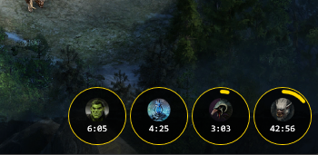

## 12. Combat phase and phase lamp

- **"Combat phase" window** — shows the current state: "FIGHT", "END" and the temporary "DROP". Drag the window with the left mouse button on the label.
- **Phase lamp** — a soft flash of the status colour at the top edge of the game window, under the title bar. The lamp is flat on top and rounded at the bottom, 64 px high and one third of the game window wide (minimum 180 px). It is click-through, does not appear in the taskbar or Alt+Tab, flashes only on a status change and fades out after about 2.7 seconds.
- **Bind to game window** — when enabled, the lamp flashes at the top edge of the game window and hides when the game is minimised or not focused; when disabled, it always stays at the top edge of the monitor.
- **Lamp highlights** — separate checkboxes for the statuses: FIGHT (purple), Yellow (fight ending), END (green), DROP (the rarity colour of the dropped item).
- **Lamp settings** — transparency, width and lifetime. The opacity curve: 0% is twice as dense as the factory default, 40% is the default, 100% is fully transparent.
- **Yellow phase sound** — configured separately and plays even when the phase window is off.

## 13. Sounds

- **Separate "Sounds" window** — all program signals in one place, 13 slots:
  - **Rar** — "Rar — mine", "Rar — party";
  - **Fight phase** — "Yellow phase (fight end)";
  - **Favorites** — "Favorite dropped";
  - **Goals** — gold, psychoexperience, shards, item set, event counter;
  - **Events** — 15 minutes before start, 5 minutes before start, event start, 15-minute timer end.
- **For each slot:** "File…" to choose a sound, "▶" to play a test, "✕" to remove the file.
- **Master volume** — one control for all sounds; the "Clear all sounds" button.
- A sound plays only where a file is selected. Event signals play only for selected (observed) events.

## 14. Data and import

- **Import from BrokenHud** — migrate sessions from a third-party tool in the live format:
  only boss fights go into instances. After the import a summary is shown: total fights,
  new instances, items, drifs and orbs, rares, sets, epics and synergetics, as well as how
  many were discarded (outside instances and without a real boss).
- **Import of our database** and the **"Merge characters"** window — merge character statistics.
- **Fast database start** — the database opens noticeably faster while the history is kept.

## 15. Interface and languages

- **Languages**: Russian, English, Polish (language switch requires a restart).
- **Custom window header** — every HUD window has its own title bar and frame in a unified
  style; windows can be moved, minimised and closed like regular ones.
- **Background colours** — 19 near-black shades in two groups: "Dark" (Black, Graphite,
  Navy blue, Teal, Pine, Wine, Night violet, Sepia) and "Dense" (Scarlet, Rust, Pumpkin,
  Olive, Steel blue, Petrol, Emerald, Amethyst, Magenta, Asphalt, Crimson).
- **Textures** — 15 seamless textures: Paper, Wood, Metal, Stone, Fabric, Leather,
  Parchment, Burlap, Marble, Rust, Carbon, Sand, Velvet, Granite, Concrete. A texture
  combines with any background colour.
- **Display settings** — per window: background colour, texture, font, text size and
  opacity; the "Apply to all windows" button.
- **In-game style cursor** — a 26 px arrow and hand.
- **Instant tooltips** — tooltips appear without delay.
- **Unified styles** — dark context menus, shared list, combo box and scrollbar styles.
- Links to useful resources in the main menu.

---

## System requirements

- **Windows 10/11**
- **Npcap** (network packet capture driver) — download at [npcap.com](https://npcap.com/)
- .NET is not required — the runtime is bundled into the installer

## Installation and launch

1. Download `anteikuHUD_setup.exe` from the **Releases** page.
2. Run the installer (installs to the user folder, no administrator rights needed).
3. Launch anteikuHUD and, if necessary, right-click → "Run as administrator".
4. After the HUD starts, launch **Broken Ranks** and log in as a character.

## Status

The project is under active development. Changes and minor inconsistencies are possible.
The source code is not published.
