# anteikuHUD — описание функций

**Русский** · [English](README.en.md) · [Polski](README.pl.md)

**HUD-статистика для игры Broken Ranks**: оверлей поверх игры, который вживую показывает статистику фарма, расходов, прибыли, целей и событий.
Все данные хранятся локально в базе SQLite — история накапливается между запусками.

---

## 1. Захват и связь с игрой

- **Чтение сетевых пакетов** через Npcap — программа видит события игры в реальном времени
  (бой, лут, золото, опыт и т.д.). В игру ничего не внедряется, пакеты не отправляются,
  клиент не изменяется.
- **Выбор устройства захвата** (меню «Устройство захвата…») — если трафик идёт через VPN или
  другой сетевой адаптер, можно указать нужный; VPN-адаптеры помечены бейджем в списке.
- **Смена устройства захвата** — программа корректно перезапускается.
- Для захвата пакетов нужен запуск **от имени администратора** (первый запуск — обязательно).

## 2. Главное окно HUD

HUD состоит из **двух окон**: шапки с панелью быстрого запуска и отдельного окна плиток
со статистикой. В свёрнутом виде видна только шапка; при наведении на неё плитки
разворачиваются мгновенно, без задержки. Перетаскивание за плитки двигает весь HUD вместе
с шапкой.

- **Живая статистика сессии и боёв** — осколки, психоопыт, золото, эссенции.
- **Строки HUD** (порядок настраивается): Сессия, Инст., Золото, Прибыль, Расходы, Инстансы,
  Опыт, Психо, Рейтинг, Серия, Рар. У Прибыли, Расходов, Серии и Рара есть отдельные окна
  и компактные мини-версии в полосе HUD.
- **Панель быстрого запуска** в шапке: Хранилище, Чемпионы, Чаты, Рынок — открывают
  соответствующие окна одним нажатием.
- **Режимы размещения:**
  - **обычный** — шапка сверху, плитки под ней;
  - **«Шапка внизу (зеркально)»** — шапка прикреплена к низу, содержимое разворачивается
    вверх, а окна выстраиваются над HUD;
  - **«Полоса HUD у края»** — узкая полоса у левого или правого края экрана: в свёрнутом
    виде 38 px, при наведении разворачивается до 232 px с мини-доком иконок и значений.
    Полоса и зеркальный режим взаимоисключающие.
- **Привязка к окну игры** — HUD (и полоса) следует за окном игры, а не за краем монитора;
  одна настройка действует на оба режима.
- **Отображение и скрытие** — галка «Привязывать отображение к игре» и список окон HUD:
  когда игра свёрнута или не в фокусе, отмеченные окна скрываются, остальные остаются
  на экране. По умолчанию вместе с игрой сворачиваются Рынок, Хранилище, Сборка, Чаты
  и Лампа фазы; для каждого окна галка «Сворачивать» настраивается отдельно, изменения
  сохраняются сразу.
- **Настройки HUD:** автосворачивание, масштаб HUD, прозрачность шапки, плиток и окна
  плиток, подложки полосы (0% — плотный чёрный, 100% — полностью прозрачно), порядок
  разделов, шрифты и цвета.
- **Горячие клавиши:**
  - `Ctrl+F2` — скрытие/отображение HUD;
  - `Ctrl+F3` — режим показа таймеров ивентов: все кружки или только те, до старта которых
    осталось не больше 15 минут.

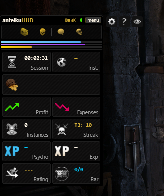

## 3. Прибыль, расходы и рынок

- **Окно «Прибыль»** — что вынесено из инстансов за сессию. В шапке — «Всего осколков»
  и «Всего эссенций». Категории показаны вкладками, и вкладка появляется только тогда,
  когда в ней что-то есть: Рары, Сеты, Эпики, Синергетики, Дрифы, Орбы, Предметы.
  - В шапке каждой вкладки — число позиций и сумма осколков/эссенций по категории.
  - Все позиции показаны плитками с иконками; одинаковые синергетики объединены
    с количеством, ингибитор учитывается по каждому предмету.
  - **Молоточек аукциона** на плитке, в шапке группы и в шапке окна открывает карточку
    рынка: цена за штуку и всего, в золоте и платине, в осколках и эссенциях, с ингибитором
    и без. Если цен нет — подсказка «нет цен — открой торг».
  - Выбранная вкладка запоминается.
- **Строка «Расходы»** — сессионные траты (покупки, плата за вход, NPC-операции);
  у строки есть своё окно с разбивкой по позициям.
- **Окно «Рынок»** — свежие цены, которые HUD пассивно записывает из игрового торга.
  Программа не запрашивает пакеты: каждое новое наблюдение заменяет старые данные
  по своему участку.
  - В шапке — шесть валютных кнопок: Платиновый ящик 10, Платиновый ящик 50, Эссенция,
    Осколок, Реол, Двигг. Показаны цена и изменение ▲/▼ в процентах, в подсказке —
    последние 7 изменений цены.
  - Вкладки «Все», «Предметы», «Дрифы», «Орбы»; пустые вкладки скрываются.
  - Поиск по названию, плитки 7×3 и постраничный вывод по 21 позиции.
  - Клик по плитке открывает карточку: золото и платина (приоритет у золота), дрифы
    считаются в эссенциях, орбы — в осколках; значения показаны с ингибитором и без.
    Закрытие — `Esc` или клик мимо карточки.
  - При изменении курса валют всплывает уведомление «было → стало».
  - Цены рынка — **справочные**: прибыль по-прежнему считается по фактическим сделкам.

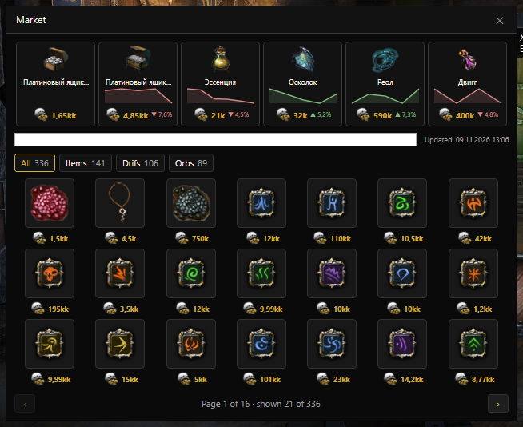

## 4. Окна статистики

Доступны окна с фильтрами периода: **сегодня, 24 часа, 7/30 дней, игровая неделя**
(с понедельника 00:00) и **игровой месяц** (с 1-го числа 00:00) — по польскому (серверному)
времени, а также фильтры по персонажам и тирам.

- **Статистика** — вкладки «Рары», «Артефакты», «Серии T» и «Боссы». Таблицы с датой,
  предметом, орнаментом (по нему можно сортировать), процентом и игроком; избранное
  отмечается звездой прямо в статистике.
- **Серии без рара по боссам** — пять постоянных вкладок Т1–Т4 и S. В каждой таблице
  «Босс · Тек. · Средн. · 1 · 2 · 3 · 4 · 5»; порядок — по последнему бою, текущий босс
  подсвечен. Если боссов тира ещё не было — «Боссы не встречались». Выбранная вкладка
  запоминается и не сбрасывается при живом обновлении.
- **Аналитика** — статистика инстансов. Вкладки:
  - **Сводка** — общая статистика по инстансам (время, опыт, психо, рары, сеты,
    синергетики, орбы, дрифы, золото, осколки и эссенции с ингибитором, доход в минуту);
  - **Заходы** — что и откуда выпадало по отдельным инстансам;
  - **Суммарно** — добыча за периоды времени, а также «Плата за боссов» и «Расходы»;
  - **По итему** — история дропа выбранного предмета, статистика по инстансам, лучший
    инстанс для фарма, количество и ингибитор, расходы и доход за заход и за час;
  - **Арена** — заходы, расходы по уровням и смерти.

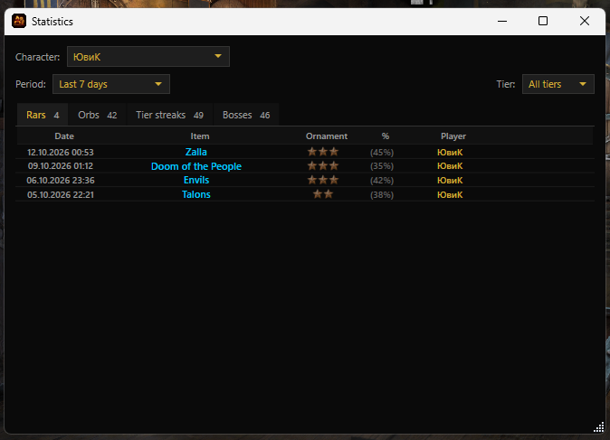

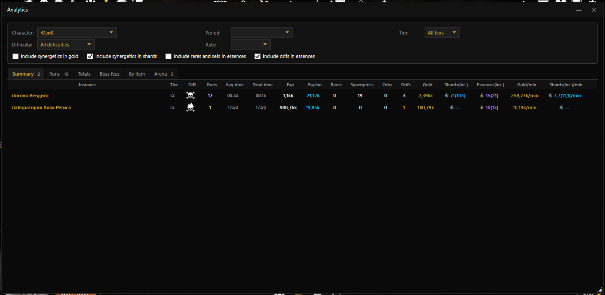

## 5. Цели и прогресс

- **Прогресс-бары целей** — отдельное окно с барами по каждой цели.
- **Живая цель: набор желаемых предметов** — задайте список предметов, и HUD подскажет,
  что из него уже выпало/собрано; выбор предметов через окно подбора.
- **ETA цели** — оценка времени до достижения цели; для лимитированных локаций —
  календарный срок; учёт капа шанса редкого предмета.
- Цели можно ставить по осколкам, психоопыту, золоту, набору предметов и счётчику ивента
  (счётчик считает пачки мобов и калибруется по трём пачкам отдельно для персонажа).
- **Звуки целей** — золото, психоопыт, осколки, набор предметов и счётчик ивента
  настраиваются в окне «Звуки».

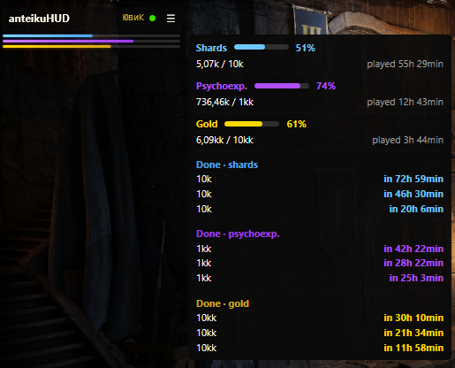

## 6. Хранилище и рюкзак

- **Просмотрщик сундуков** — содержимое всех сундуков хранилища с иконками (обновляется при входе в Хранилище в игре, каждый сундук отдельно).
- **Обзор «Все хранилища»** — общий список с подсветкой «Всё».
- **Плитки** предметов с иконками (экипировка — по полям пакета), номер сундука
  в углу плитки, иконки привязанных орбов, число под номером сундука.
- **Фильтры и категории** — поиск (в т.ч. без апострофов), чекбокс «Привязанные»,
  золотая рамка выбранного, иконки золота и платины.
- **Вкладка «Рюкзак»** — содержимое рюкзака персонажа: обновляется из игры, последнее
  состояние хранится в базе, на плитке — бейдж «Р».
- Содержимое обновляется только для тех вкладок, которые вы открывали в игре; само
  по себе ничего не исчезает. У каждой вкладки есть кнопка «Очистить», а если данных
  ещё нет — подсказка «Открой хранилище в игре — содержимое запишется само».
- Отображаются и предметы вне боя (иконка «+N» у прихода предметов).

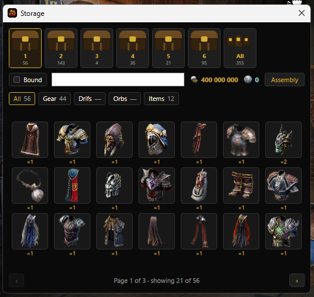

## 7. Сборка

- **Окно «Сборка»** — что из содержимого сундуков уже можно объединить
  (дрифы, орбы, синергетики) по правилам игры: дрифы сравниваются по размеру,
  орбы группируются по категории уровня, синергетики сводятся по рангу.
- **Визуал плиткой** с именами из пакета, постраничное переключение.
- Вкладка «Синэргетики» — информация о составе по рангам.

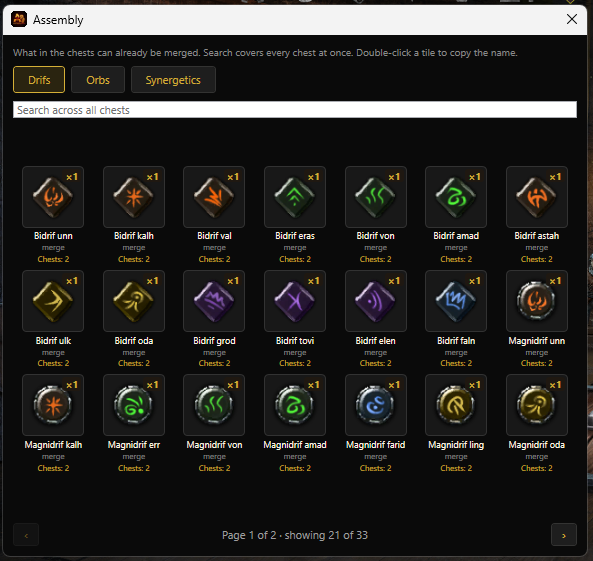

## 8. Избранное и уведомления

- **Избранное** — отмечайте ценные предметы, орбы и дрифы, экипировку для визуального оповещения при добыче.
- **Всплывающие уведомления** — иконки добычи/расхода появляются справа от шапки HUD
  на прозрачном фоне. Настраиваются размер иконки, прозрачность фона, время показа,
  цветная рамка, подсветка при наведении и показ названия при наведении.
- **Уведомления об изменении цен** — при изменении курса валюты на рынке всплывает
  сообщение «было → стало».

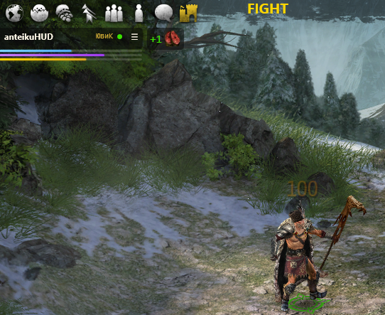

## 9. Ловим чемпионов (трекер респауна)

- **Каталог чемпионов** — все чемпионы Broken Ranks с их временем возрождения, сгруппированные
  по локациям; в окне четыре вкладки: **«Запущенные»**, **«Избранные»**, **«Все»**
  и **«Автофиксация»**.
- **Таймеры респауна** — клик по плитке запускает обратный отсчёт до возрождения чемпиона.
  Отсчёт идёт по времени из каталога (у чемпионов с разбросом — от минимального).
- **Вкладка «Запущенные»** — только живые таймеры: и те, что ещё идут до респауна, и те,
  где респаун уже наступил (зелёное окно). Список сам обновляется по ходу отсчёта.
- **Зелёное окно респауна** — когда отсчёт дошёл до нуля, плитка переходит в зелёный счётчик
  «РЕСПАУН M:SS»: респаун уже возможен и длится столько-то (разница между минимальным и
  максимальным временем). Когда окно закрывается, таймер обнуляется.
- **Предупреждение «скоро респаун»** — за 5 минут до возрождения чемпиона.
- **Значки в полосе уведомлений у HUD** — готовность чемпиона показана иконкой рядом с
  главным окном; клик по значку открывает окно трекера.
- **Избранные** — звезда ★ на плитке добавляет чемпиона в избранное; по убийству такого
  чемпиона всплывает пузырь «Запустить таймер?» — таймер запускается одним нажатием.
- **Автофиксация** — кнопка «А» на плитке добавляет чемпиона в автофиксацию (с ★
  взаимоисключающе). По убийству такого чемпиона таймер запускается сам, без пузыря.
  Вкладка доступна во всех сборках, включая релизную.
- **Фильтр по имени** — строка «Фильтр по имени чемпиона…»; `Esc` очищает фильтр.
- **Удвоенные чемпионы** — Гробница и Никсоцвет живут в локации по две копии: у каждого две
  плитки с отдельными таймерами.
- **Тултип плитки** — время респауна и подсказка, сколько чемпион простаивает до исчезновения.
- **Несколько мониторов** — таймеры и значки корректно работают при любом положении HUD.

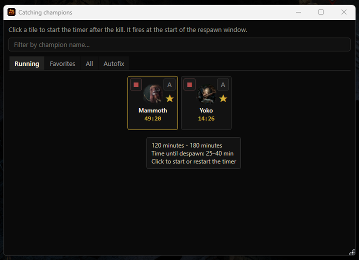

## 10. Чат

- **Слежение за игровым чатом** — окно «Чаты» (меню «Чаты») записывает сообщения игры
  в реальном времени, ищет ключевые слова и показывает уведомления.
- **Главный выключатель** — «Записывать и обрабатывать чат»; по умолчанию чат **выключен**.
  Пока галка не стоит, сообщения не пишутся, не проверяются на триггер-слова и не дают
  уведомлений. Состояние запоминается между запусками.
- **Лог сообщений** — таблица «Время · Ник · Сообщение», новые сверху; упоминание вашего
  ника подсвечивается золотым, сработавший триггер — оранжевым. Автопрокрутка, поиск по
  нику/тексту, копирование по правому клику (ник / сообщение / всё), очистка файла и
  открытие лога в редакторе.
- **Фильтр по персонажам** — показывать только отмеченных; **игнор** — скрыть выбранных
  из лога и отключить по ним уведомления (сообщения при этом продолжают писаться в файл).
- **Триггер-слова** — список ключевых слов, по которым всплывает уведомление: добавление,
  правка прямо в строке (двойной клик), удаление и **галка включения/отключения слова** —
  снятая галка временно отключает поиск, слово остаётся в списке и приглушается.
- **Нечёткий поиск** — ловит склонения и опечатки: первая буква должна совпадать, точное
  вхождение с начала слова, иначе допускается 1–2 опечатки (слова короче 4 букв — только
  точно; триггеры, начинающиеся не с буквы, — точным вхождением). Комбинация слов
  срабатывает, когда все слова есть в сообщении в любом порядке.
- **Уведомления** — всплывающий тост в правом нижнем углу (7 секунд) и «липкий» значок
  непрочитанных со счётчиком в полосе уведомлений, пока окно «Чаты» не откроют.
- **Файл лога** — `chat_log.txt` рядом с программой, UTF-8 без BOM; в памяти — последние
  3000 сообщений, в файле — все (галка «Вся история» читает файл за все дни).
- **Локализация** — русский, английский, польский.

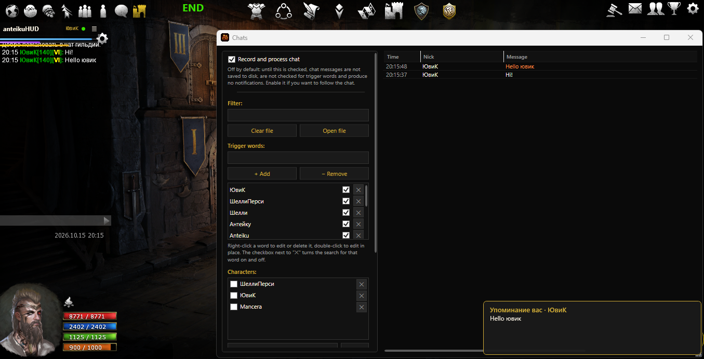

## 11. Ивенты

- **Выбор ивентов** — какие показывать, требуется открыть карту в игре.
- **Таймеры ивентов** — кружки-таймеры на экране (появление за 15 минут до начала,
  автопродление для Ястреб/Вендиго).
- **Отображение** — стандартное: текстом, экспериментальное: круглыми иконками и визуальным
  отсчётом таймера как на карте в игре. Кружки заполняются по реальному циклу и имеют
  разрыв сверху.
- **Режим показа** — `Ctrl+F3` переключает все кружки или только те, до старта которых
  осталось не больше 15 минут.
- **Привязка к краю экрана** и зеркальная раскладка (для нескольких мониторов),
  размер кружков запоминается.
- **Звуки ивентов** — за 15 минут до старта, за 5 минут, старт и конец 15-минутного
  таймера настраиваются в окне «Звуки».

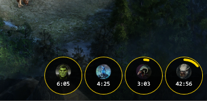

## 12. Фаза боя и лампа фазы

- **Окно «Фаза боя»** — показывает текущее состояние: «БОЙ», «КОНЕЦ» и временное «ДРОП».
  Окно перетаскивается левой кнопкой мыши за надпись.
- **Лампа фазы** — мягкая вспышка цвета статуса у верхнего края окна игры, под заголовком.
  Лампа плоская сверху и скруглена снизу, высота 64 px, ширина — треть окна игры
  (минимум 180 px). Она не принимает клики, не показывается в панели задач и Alt+Tab,
  вспыхивает только при смене статуса и гаснет примерно через 2,7 секунды.
- **Привязка к окну игры** — при включённой галке лампа вспыхивает у верха окна игры
  и скрывается, когда игра свёрнута или не в фокусе; при выключенной — всегда находится
  у верхнего края монитора.
- **Подсветка лампы** — отдельные галки для статусов: БОЙ (фиолетовый), Жёлтый (конец боя),
  КОНЕЦ (зелёный), ДРОП (цвет редкости выпавшего предмета).
- **Настройки лампы** — прозрачность, ширина и время жизни. Кривая прозрачности: 0% —
  вдвое плотнее заводской, 40% — заводская, 100% — полностью прозрачно.
- **Звук жёлтой фазы** — настраивается отдельно и звучит даже при выключенном окне фазы.

## 13. Звуки

- **Отдельное окно «Звуки»** — все сигналы программы в одном месте, 13 слотов:
  - **Рар** — «Рар — мне», «Рар — пати»;
  - **Фаза боя** — «Жёлтая фаза (конец боя)»;
  - **Избранное** — «Выпало избранное»;
  - **Цели** — золото, психоопыт, осколки, набор предметов, счётчик ивента;
  - **Ивенты** — за 15 минут до старта, за 5 минут до старта, старт ивента,
    конец 15-минутного таймера.
- **Для каждого слота:** «Файл…» — выбрать звук, «▶» — проиграть проверку, «✕» — убрать файл.
- **Общая громкость** — один регулятор на все звуки; кнопка «Очистить все звуки».
- Звук играет только там, где выбран файл. Ивентовые сигналы звучат только для выбранных
  (наблюдаемых) ивентов.

## 14. Данные и импорт

- **Импорт из BrokenHud** — перенос сессий из сторонней программы в живом формате:
  в инстансы попадают только бои с боссами. После импорта показывается сводка: всего боёв,
  новых инстансов, предметов, дрифов и орбов, раров, сетов, эпиков и синергетиков,
  а также сколько отброшено (вне инстансов и без настоящего босса).
- **Импорт нашей БД** и окно **«Объединить персонажей»** — слияние статистики персонажей.
- **Быстрый запуск базы** — база открывается заметно быстрее, история при этом сохраняется.

## 15. Интерфейс и языки

- **Языки**: русский, английский, польский (смена языка — с перезапуском).
- **Своя шапка окна** — у всех окон HUD собственный заголовок и рамка в едином стиле;
  окна можно двигать, сворачивать и закрывать как обычные.
- **Цвета фона** — 19 почти чёрных оттенков в двух группах: «Тёмные» (Чёрный, Графит,
  Тёмно-синий, Тёмно-бирюзовый, Хвоя, Бордовый, Ночной фиолетовый, Сепия) и «Плотные»
  (Алый, Ржавый, Тыква, Олива, Стальной синий, Петроль, Изумруд, Аметист, Магента,
  Асфальт, Багровый).
- **Фактуры** — 15 бесшовных текстур: Бумага, Дерево, Металл, Камень, Ткань, Кожа,
  Пергамент, Мешковина, Мрамор, Ржавчина, Карбон, Песок, Бархат, Гранит, Бетон.
  Фактура сочетается с любым цветом фона.
- **Настройки отображения** — для каждого окна отдельно: цвет фона, фактура, шрифт,
  размер текста и прозрачность; кнопка «Применить ко всем».
- **Курсор как в игре** — стрелка и рука размером 26 px.
- **Подсказки без задержки** — тултипы появляются мгновенно.
- **Единые стили** — тёмные контекстные меню, общие стили списков, выпадающих списков
  и полос прокрутки.
- Ссылки на полезные ресурсы в главном меню.

---

## Системные требования

- **Windows 10/11**
- **Npcap** (драйвер захвата сетевых пакетов) — скачать на [npcap.com](https://npcap.com/)
- .NET не требуется — в установщик встроен runtime

## Установка и запуск

1. Скачайте `anteikuHUD_setup.exe` со страницы **Releases**.
2. Запустите установщик (установка в папку пользователя, без прав администратора).
3. Запустите anteikuHUD и, при необходимости, ПКМ → «Запуск от имени администратора».
4. После запуска HUD запустите игру **Broken Ranks** и войдите на персонажа.

## Статус

Проект находится в стадии активной разработки. Возможны изменения и небольшие несоответствия.
Исходный код не публикуется.
