# anteikuHUD — opis funkcji

**Statystyki HUD do gry Broken Ranks**: nakładka na grę, która na żywo pokazuje statystyki farmienia, wydatków, zysku, celów i wydarzeń. Wszystkie dane są przechowywane lokalnie w bazie SQLite — historia gromadzi się między uruchomieniami.

[Русский](README.md) · [English](README.en.md) · **Polski**

---

## 1. Przechwytywanie i połączenie z grą

- **Odczyt pakietów sieciowych** przez Npcap — program widzi wydarzenia gry w czasie rzeczywistym (walki, łupy, złoto, doświadczenie itd.). Do gry nic nie jest wstrzykiwane, pakiety nie są wysyłane, klient nie jest zmieniany.
- **Wybór urządzenia przechwytywania** (menu „Urządzenie przechwytywania…") — jeśli ruch idzie przez VPN lub inną kartę sieciową, można wskazać właściwe; adaptery VPN są oznaczone odznaką na liście.
- **Zmiana urządzenia przechwytywania** — program poprawnie się restartuje.
- Do przechwytywania pakietów wymagane jest uruchomienie **jako administrator** (przy pierwszym uruchomieniu — obowiązkowo).

## 2. Główne okno HUD

HUD składa się z **dwóch okien**: nagłówka z panelem szybkiego startu i osobnego okna kafli ze statystykami. Po zwinięciu widoczny jest tylko nagłówek; po najechaniu na niego kafle rozwijają się natychmiast, bez opóźnienia. Przeciąganie za kafle przesuwa cały HUD razem z nagłówkiem.

- **Statystyki sesji i walk na żywo** — odłamki, psychodoświadczenie, złoto, esencje.
- **Wiersze HUD** (kolejność można zmieniać): Sesja, Inst., Złoto, Zysk, Wydatki, Instancje, Dośw., Psycho, Rating, Seria, Rar. Zysk, Wydatki, Seria i Rar mają własne okna oraz kompaktowe miniatury na pasku HUD.
- **Panel szybkiego startu** w nagłówku: Depozyt, Czempiony, Czaty, Rynek — otwierają odpowiednie okna jednym kliknięciem.
- **Tryby rozmieszczenia:**
  - **zwykły** — nagłówek u góry, kafle pod nim;
  - **„Nagłówek na dole (lustrzanie)"** — nagłówek przypięty do dołu, zawartość rozwija się w górę, a okna układają się nad HUD;
  - **„Pasek HUD przy krawędzi"** — wąski pasek przy lewej lub prawej krawędzi ekranu: 38 px po zwinięciu, rozwija się do 232 px po najechaniu, z mini-dokiem ikon i wartości. Pasek i tryb lustrzany wykluczają się wzajemnie.
- **Przywiązanie do okna gry** — HUD (i pasek) trzyma się okna gry, a nie krawędzi monitora; jedno ustawienie działa dla obu trybów.
- **Wyświetlanie i ukrywanie** — pole „Powiąż wyświetlanie z grą" i lista okien HUD: gdy gra jest zminimalizowana lub bez fokusu, zaznaczone okna są ukrywane, a pozostałe zostają na ekranie. Domyślnie razem z grą zwijają się Rynek, Depozyt, Składanie, Czaty i Lampa fazy; każde okno ma własne pole „Zwijaj", a zmiany zapisują się natychmiast.
- **Ustawienia HUD:** automatyczne zwijanie, skala HUD, przezroczystość nagłówka, kafli i okna kafli, tła paska (0% — pełna czerń, 100% — pełna przezroczystość), kolejność sekcji, czcionki i kolory.
- **Skróty klawiszowe:**
  - `Ctrl+F2` — ukryj/pokaż HUD;
  - `Ctrl+F3` — tryb wyświetlania timerów wydarzeń: wszystkie kółka lub tylko te, do których startu zostało nie więcej niż 15 minut.

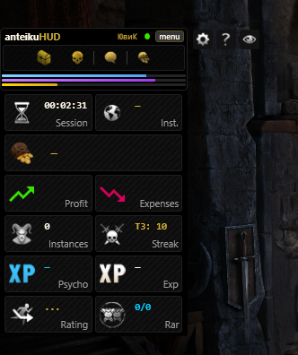

## 3. Zysk, wydatki i rynek

- **Okno „Zysk"** — co zostało wyniesione z instancji w trakcie sesji. W nagłówku — „Łącznie odłamków" i „Łącznie esencji". Kategorie są pokazane jako zakładki, a zakładka pojawia się tylko wtedy, gdy coś w niej jest: Rary, Sety, Epiki, Synergetyki, Drify, Orby, Przedmioty.
  - W nagłówku każdej zakładki — liczba pozycji i suma odłamków/esencji dla kategorii.
  - Wszystkie pozycje są pokazane jako kafle z ikonami; identyczne synergetyki są scalone z ilością, inhibitor jest liczony dla każdego przedmiotu.
  - **Młotek aukcyjny** na kaflu, w nagłówku grupy i w nagłówku okna otwiera kartę rynku: cena za sztukę i łącznie, w złocie i platynie, w odłamkach i esencjach, z inhibitorem i bez. Jeśli nie ma cen — podpowiedź „brak cen — otwórz targ".
  - Wybrana zakładka jest zapamiętywana.
- **Wiersz „Wydatki"** — wydatki sesji (zakupy, opłaty za wejście, operacje NPC); wiersz ma własne okno z rozbiciem na pozycje.
- **Okno „Rynek"** — świeże ceny, które HUD pasywnie zapisuje z targu w grze. Program nie wysyła zapytań o pakiety: każde nowe obserwacje zastępują stare dane w swoim obszarze.
  - W nagłówku — sześć przycisków walut: Platynowa Paczka 10, Platynowa Paczka 50, Esencja, Odłamek, Reol, Dvigg. Pokazana jest cena i zmiana ▲/▼ w procentach, a w podpowiedzi — ostatnie 7 zmian ceny.
  - Zakładki „Wszystko", „Przedmioty", „Drify", „Orby"; puste zakładki są ukrywane.
  - Wyszukiwanie po nazwie, kafle 7×3 i stronicowanie po 21 pozycji.
  - Kliknięcie kafla otwiera kartę: złoto i platyna (priorytet ma złoto), drify liczone są w esencjach, orby w odłamkach; wartości są pokazane z inhibitorem i bez. Zamknięcie — `Esc` lub kliknięcie obok karty.
  - Przy zmianie kursu waluty pojawia się powiadomienie „było → jest".
  - Ceny rynku są **orientacyjne**: zysk nadal liczony jest z faktycznych transakcji.

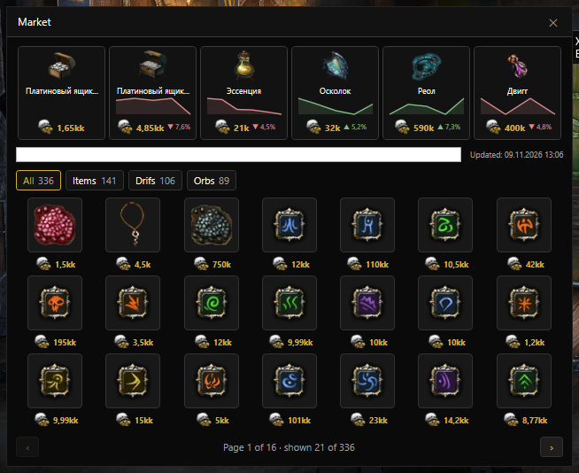

## 4. Okna statystyk

Dostępne okna z filtrami okresu: **dzisiaj, 24 godziny, 7/30 dni, tydzień gry** (od poniedziałku 00:00) oraz **miesiąc gry** (od 1. dnia 00:00) — według czasu polskiego (serwerowego), a także filtry według postaci i tierów.

- **Statystyki** — zakładki „Rary", „Orby", „Serie T" i „Bossy". Tabele pokazują datę, przedmiot, ornament (można sortować), procent i gracza; ulubione można oznaczać gwiazdką bezpośrednio w statystykach.
- **Serie bez rara u bossów** — pięć stałych zakładek T1–T4 i S. W każdej tabeli „Boss · Bież. · Śr. · 1 · 2 · 3 · 4 · 5"; kolejność według ostatniej walki, bieżący boss jest podświetlony. Jeśli w tierze nie było jeszcze bossów — „Bossy nie spotkani". Wybrana zakładka jest zapamiętywana i nie resetuje się przy odświeżaniu na żywo.
- **Analiza** — statystyki instancji. Zakładki:
  - **Podsumowanie** — ogólne statystyki instancji (czas, doświadczenie, psycho, rary, sety, synergetyki, orby, drify, złoto, odłamki i esencje z inhibitorem, dochód na minutę);
  - **Wejścia** — co i skąd wypadło w poszczególnych instancjach;
  - **Łącznie** — zdobycz za okresy czasu, a także „Opłaty za bossów" i „Wydatki";
  - **Po przedmiocie** — historia dropu wybranego przedmiotu, statystyki według instancji, najlepsza instancja do farmienia, ilość i inhibitor, wydatki i dochód na wejście oraz na godzinę;
  - **Arena** — wejścia, wydatki według poziomów i śmierci.

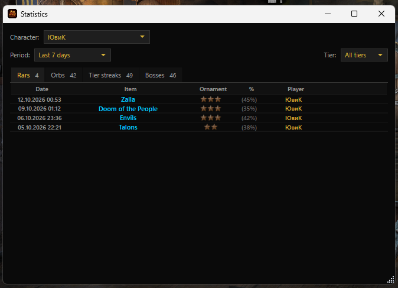

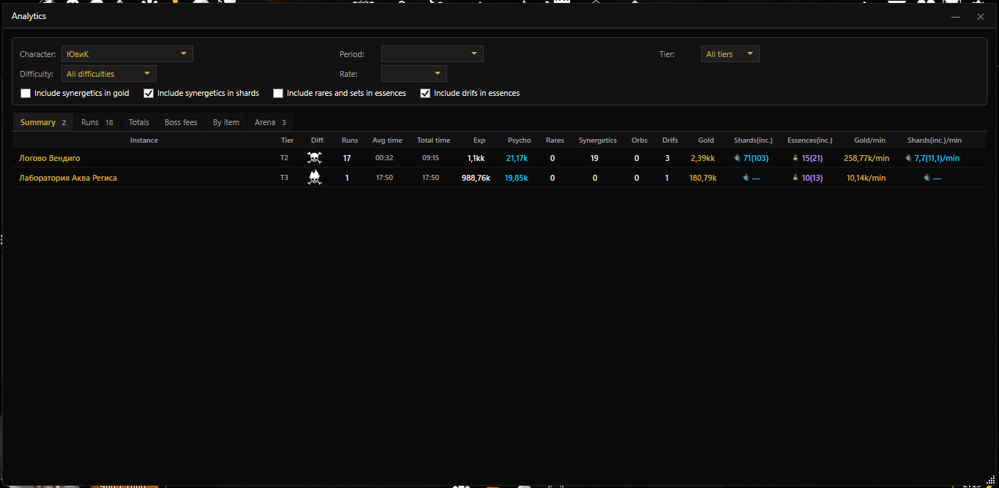

## 5. Cele i postęp

- **Paski postępu celów** — osobne okno z paskiem dla każdego celu.
- **Cel na żywo: zestaw pożądanych przedmiotów** — ustaw listę przedmiotów, a HUD podpowie, co już wypadło/zebrano; wybór przedmiotów przez okno wyboru.
- **ETA celu** — oszacowanie czasu do osiągnięcia celu; dla ograniczonych lokacji — termin kalendarzowy; uwzględnia limit szansy na rara.
- Cele można ustawiać na odłamki, psycho, złoto, zestaw przedmiotów i licznik eventu (licznik zlicza paczki mobów i jest kalibrowany trzema paczkami osobno dla postaci).
- **Dźwięki celów** — złoto, psychodoświadczenie, odłamki, zestaw przedmiotów i licznik eventu ustawia się w oknie „Dźwięki".

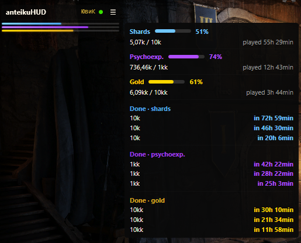

## 6. Depozyt i plecak

- **Przeglądarka skrzyń** — zawartość wszystkich skrzyń depozytu z ikonami (odświeżane przy wejściu do Depozytu w grze, każda skrzynia osobno).
- **Widok „Wszystkie depozyty"** — wspólna lista z podświetleniem „Wszystko".
- **Kafelki** przedmiotów z ikonami (ekwipunek — z pól pakietu), numer skrzyni w rogu kafelka, ikony przypiętych orbów, liczba pod numerem skrzyni.
- **Filtry i kategorie** — wyszukiwanie (w tym bez apostrofów), checkbox „Przypięte", złota ramka zaznaczenia, ikony złota i platyny.
- **Zakładka „Plecak"** — zawartość plecaka postaci: aktualizowana z gry, ostatni stan zapisany w bazie, na kaflu odznaka „R".
- Zawartość aktualizuje się tylko dla zakładek otwieranych w grze; nic nie znika samo. Każda zakładka ma przycisk „Wyczyść", a jeśli nie ma jeszcze danych — podpowiedź „Otwórz depozyt w grze — zawartość zapisze się sama".
- Wyświetlane są także przedmioty poza walką (ikona „+N" przy przychodzących przedmiotach).

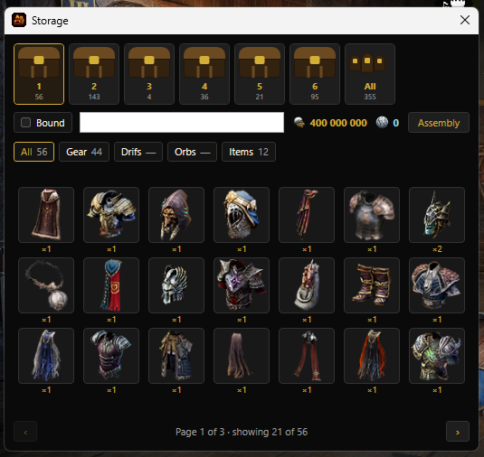

## 7. Składanie

- **Okno „Składanie"** — co z zawartości skrzyń można już połączyć (drify, orby, synergistyczne) według zasad gry: drify porównywane po rozmiarze, orby grupowane po kategorii poziomu, synergistyczne zbierane po randze.
- **Widok kafelkowy** z nazwami z pakietu, przewijanie stronami.
- Zakładka „Synergistyczne" — informacja o składzie według rang.

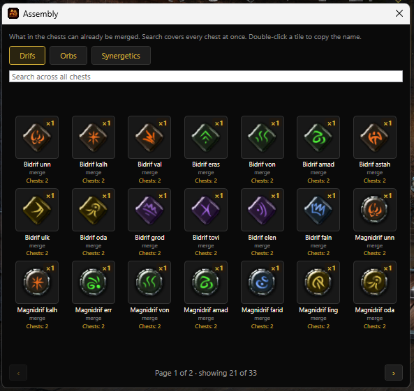

## 8. Ulubione i powiadomienia

- **Ulubione** — zaznaczaj cenne przedmioty, orby i drify, ekwipunek do wizualnego powiadamiania przy zdobyciu.
- **Wyskakujące powiadomienia** — ikony zdobyczy/wydatków pojawiają się po prawej stronie nagłówka HUD na przezroczystym tle. Konfigurowalne są rozmiar ikony, przezroczystość tła, czas wyświetlania, kolorowa ramka, podświetlenie po najechaniu i pokazywanie nazwy po najechaniu.
- **Powiadomienia o zmianie cen** — przy zmianie kursu waluty na rynku pojawia się komunikat „było → jest".

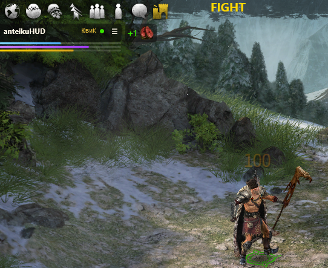

## 9. Łowienie czempionów (tracker respawnu)

- **Katalog czempionów** — wszystkie czempiony Broken Ranks z czasem odrodzenia, pogrupowane
  według lokacji; okno ma cztery zakładki: **„Uruchomione"**, **„Ulubione"**, **„Wszyscy"**
  i **„Autofix"**.
- **Timery respawnu** — kliknięcie kafelka uruchamia odliczanie do odrodzenia czempiona.
  Odliczanie korzysta z czasu z katalogu (dla czempionów z zakresem — od minimalnego).
- **Zakładka „Uruchomione"** — tylko żywe timery: zarówno te wciąż odliczające do respawnu,
  jak i te, których respawn już nastąpił (zielone okno). Lista odświeża się sama w miarę upływu czasu.
- **Zielone okno respawnu** — gdy odliczanie osiągnie zero, kafelek przechodzi w zielony licznik
  „RESPAWN M:SS": respawn jest już możliwy i trwa tyle (różnica między czasem minimalnym
  a maksymalnym). Gdy okno się zamyka, timer się zeruje.
- **Ostrzeżenie „wkrótce respawn"** — 5 minut przed odrodzeniem czempiona.
- **Ikony na pasku powiadomień przy HUD** — gotowość czempiona pokazana jako ikona obok
  głównego okna; kliknięcie ikony otwiera okno trackera.
- **Ulubione** — gwiazdka ★ na kafelku dodaje czempiona do ulubionych; gdy taki czempion
  zostanie zabity, wyświetla się dymek „Uruchomić timer?" — timer startuje jednym kliknięciem.
- **Autofix** — przycisk „A" na kafelku dodaje czempiona do Autofix (wyklucza się z ★).
  Po zabiciu takiego czempiona timer startuje sam, bez dymka. Zakładka jest dostępna
  we wszystkich buildach, także w wydaniu.
- **Filtr po nazwie** — pole „Filtr po nazwie czempiona…"; `Esc` czyści filtr.
- **Podwojone czempiony** — Grobowiec i Niksoflor żyją w lokacji jako dwie kopie: każda dostaje
  dwa kafelki z osobnymi timerami.
- **Podpowiedź kafelka** — czas respawnu i wskazówka, jak długo czempion czeka przed zniknięciem.
- **Wiele monitorów** — timery i ikony działają poprawnie przy dowolnym położeniu HUD.

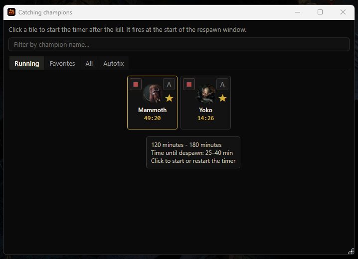

## 10. Czat

- **Śledzenie czatu w grze** — okno „Czaty" (menu „Czaty") zapisuje wiadomości gry w czasie
  rzeczywistym, szuka słów kluczowych i pokazuje powiadomienia.
- **Główny przełącznik** — „Nagrywaj i przetwarzaj czat"; czat jest domyślnie **wyłączony**.
  Gdy pole nie jest zaznaczone, wiadomości nie są zapisywane, nie są sprawdzane pod kątem
  słów-triggerów i nie dają powiadomień. Stan jest zapamiętywany między uruchomieniami.
- **Dziennik wiadomości** — tabela „Czas · Nick · Wiadomość", najnowsze na górze; wzmianka
  o twoim nicku jest podświetlona na złoto, uruchomiony trigger — na pomarańczowo.
  Automatyczne przewijanie, wyszukiwanie po nicku/tekście, kopiowanie prawym przyciskiem
  (nick / wiadomość / wszystko), czyszczenie pliku i otwieranie dziennika w edytorze.
- **Filtr postaci** — pokazuj tylko zaznaczone; **ignorowanie** — ukryj wybrane z dziennika
  i wycisz ich powiadomienia (wiadomości nadal trafiają do pliku).
- **Słowa-triggery** — lista słów kluczowych, przy których pojawia się powiadomienie:
  dodawanie, edycja w miejscu (podwójne kliknięcie), usuwanie oraz **pole wyboru
  włączenia/wyłączenia słowa** — odznaczone tymczasowo wyłącza szukanie, słowo pozostaje
  na liście i jest przygaszone.
- **Wyszukiwanie rozmyte** — łapie odmiany i literówki: pierwsza litera musi się zgadzać,
  dokładne wystąpienie od początku słowa, w przeciwnym razie dopuszczalne 1–2 literówki
  (słowa krótsze niż 4 litery — tylko dokładnie; triggery zaczynające się od znaku
  niebędącego literą — dokładne wystąpienie). Kombinacja słów działa, gdy wszystkie słowa
  są w wiadomości w dowolnej kolejności.
- **Powiadomienia** — wyskakujący toast w prawym dolnym rogu (7 sekund) i „przyklejona"
  odznaka nieprzeczytanych z licznikiem na pasku powiadomień, dopóki okno „Czaty" nie
  zostanie otwarte.
- **Plik dziennika** — `chat_log.txt` obok programu, UTF-8 bez BOM; w pamięci ostatnie
  3000 wiadomości, w pliku — wszystkie (pole „Cała historia" czyta plik za wszystkie dni).
- **Lokalizacja** — rosyjski, angielski, polski.

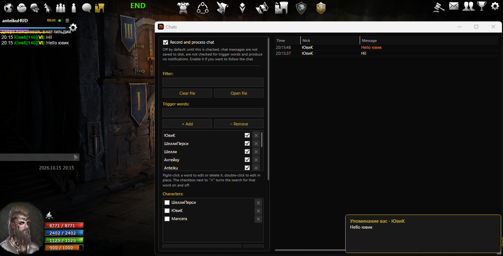

## 11. Wydarzenia

- **Wybór wydarzeń** — które pokazywać; wymaga otwarcia mapy w grze.
- **Timery wydarzeń** — okrągłe timery na ekranie (pojawiają się 15 minut przed startem, automatyczne przedłużanie dla Jastrząb/Wendigo).
- **Wyświetlanie** — standardowe: tekstem; eksperymentalne: okrągłe ikony z wizualnym odliczaniem timera jak na mapie w grze. Kółka wypełniają się zgodnie z rzeczywistym cyklem i mają przerwę u góry.
- **Tryb wyświetlania** — `Ctrl+F3` przełącza wszystkie kółka lub tylko te, do których startu zostało nie więcej niż 15 minut.
- **Przypięcie do krawędzi ekranu** i lustrzany układ (dla wielu monitorów); rozmiar kółek jest zapamiętywany.
- **Dźwięki wydarzeń** — 15 minut przed startem, 5 minut przed startem, start eventu i koniec 15-minutowego timera ustawia się w oknie „Dźwięki".

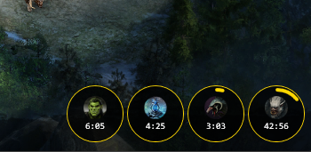

## 12. Faza walki i lampa fazy

- **Okno „Faza walki"** — pokazuje bieżący stan: „WALKA", „KONIEC" i tymczasowy „DROP". Okno przeciąga się lewym przyciskiem myszy za napis.
- **Lampa fazy** — miękki błysk koloru statusu przy górnej krawędzi okna gry, pod paskiem tytułu. Lampa jest płaska u góry i zaokrąglona u dołu, ma 64 px wysokości i szerokość równą jednej trzeciej okna gry (minimum 180 px). Nie przyjmuje kliknięć, nie pojawia się na pasku zadań ani w Alt+Tab, błyska tylko przy zmianie statusu i gaśnie po około 2,7 sekundy.
- **Przywiązanie do okna gry** — po włączeniu lampa błyska przy górnej krawędzi okna gry i znika, gdy gra jest zminimalizowana lub bez fokusu; po wyłączeniu zawsze znajduje się przy górnej krawędzi monitora.
- **Podświetlenie lampy** — osobne pola dla statusów: WALKA (purpurowy), Żółty (koniec walki), KONIEC (zielony), DROP (kolor rzadkości wypadniętego przedmiotu).
- **Ustawienia lampy** — przezroczystość, szerokość i czas trwania. Krzywa przezroczystości: 0% — dwa razy gęstsza od fabrycznej, 40% — fabryczna, 100% — całkowicie przezroczysta.
- **Dźwięk żółtej fazy** — ustawiany osobno i gra nawet przy wyłączonym oknie fazy.

## 13. Dźwięki

- **Osobne okno „Dźwięki"** — wszystkie sygnały programu w jednym miejscu, 13 slotów:
  - **Rar** — „Rar — mnie", „Rar — drużyna";
  - **Faza walki** — „Żółta faza (koniec walki)";
  - **Ulubione** — „Wypadło ulubione";
  - **Cele** — złoto, psychodoświadczenie, odłamki, zestaw przedmiotów, licznik eventu;
  - **Eventy** — 15 minut przed startem, 5 minut przed startem, start eventu,
    koniec 15-minutowego timera.
- **Dla każdego slotu:** „Plik…" — wybór dźwięku, „▶" — odtworzenie testowe, „✕" — usunięcie pliku.
- **Głośność ogólna** — jeden regulator dla wszystkich dźwięków; przycisk „Wyczyść wszystkie dźwięki".
- Dźwięk gra tylko tam, gdzie wybrano plik. Sygnały eventów grają tylko dla wybranych
  (obserwowanych) eventów.

## 14. Dane i import

- **Import z BrokenHud** — przeniesienie sesji z zewnętrznego programu w formacie na żywo:
  do instancji trafiają tylko walki z bossami. Po imporcie pokazywane jest podsumowanie:
  łącznie walk, nowych instancji, przedmiotów, drifów i orbów, rarów, setów, epików
  i synergetyków oraz ile odrzucono (poza instancjami i bez prawdziwego bossa).
- **Import naszej bazy** i okno **„Połącz postaci"** — scalenie statystyk postaci.
- **Szybki start bazy** — baza otwiera się zauważalnie szybciej, a historia zostaje zachowana.

## 15. Interfejs i języki

- **Języki**: rosyjski, angielski, polski (zmiana języka — z ponownym uruchomieniem).
- **Własny nagłówek okna** — każde okno HUD ma własny pasek tytułu i ramkę w jednolitym
  stylu; okna można przesuwać, minimalizować i zamykać jak zwykłe.
- **Kolory tła** — 19 prawie czarnych odcieni w dwóch grupach: „Ciemne" (Czarny, Grafit,
  Granatowy, Ciemno-turkusowy, Jodłowy, Bordowy, Nocny fiolet, Sepia) i „Gęste"
  (Szkarłatny, Rdzawy, Dyniowy, Oliwkowy, Stalowy niebieski, Petrolowy, Szmaragdowy,
  Ametystowy, Magenta, Asfaltowy, Karmazynowy).
- **Faktury** — 15 bezszwowych tekstur: Papier, Drewno, Metal, Kamień, Tkanina, Skóra,
  Pergamin, Płótno jutowe, Marmur, Rdza, Karbon, Piasek, Aksamit, Granit, Beton.
  Faktura łączy się z dowolnym kolorem tła.
- **Ustawienia wyświetlania** — dla każdego okna osobno: kolor tła, faktura, czcionka,
  rozmiar tekstu i przezroczystość; przycisk „Zastosuj do wszystkich okien".
- **Kursor jak w grze** — strzałka i dłoń o rozmiarze 26 px.
- **Podpowiedzi bez opóźnienia** — tooltipy pojawiają się natychmiast.
- **Jednolite style** — ciemne menu kontekstowe, wspólne style list, list rozwijanych
  i pasków przewijania.
- Linki do przydatnych zasobów w menu głównym.

---

## Wymagania systemowe

- **Windows 10/11**
- **Npcap** (sterownik przechwytywania pakietów sieciowych) — pobierz z [npcap.com](https://npcap.com/)
- .NET nie jest wymagany — runtime jest wbudowany w instalator

## Instalacja i uruchomienie

1. Pobierz `anteikuHUD_setup.exe` ze strony **Releases**.
2. Uruchom instalator (instalacja do folderu użytkownika, bez uprawnień administratora).
3. Uruchom anteikuHUD i, w razie potrzeby, prawy przycisk myszy → „Uruchom jako administrator".
4. Po uruchomieniu HUD uruchom grę **Broken Ranks** i zaloguj się na postać.

## Status

Projekt jest w fazie aktywnego rozwoju. Możliwe są zmiany i drobne nieścisłości.
Kod źródłowy nie jest publikowany.
