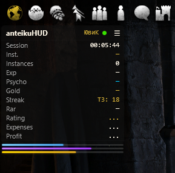
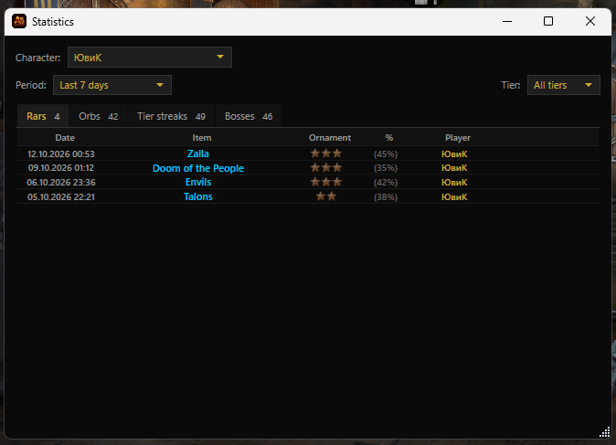
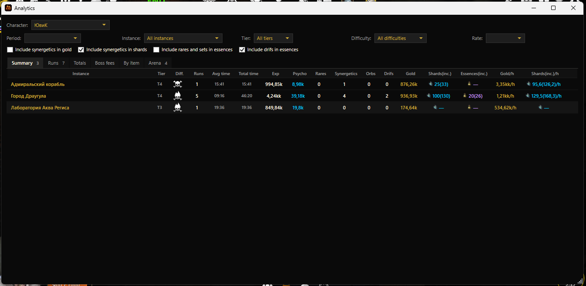
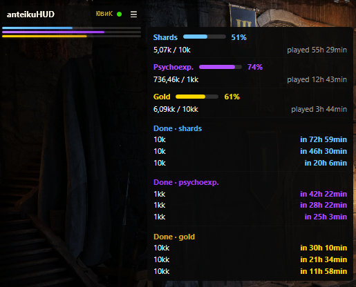
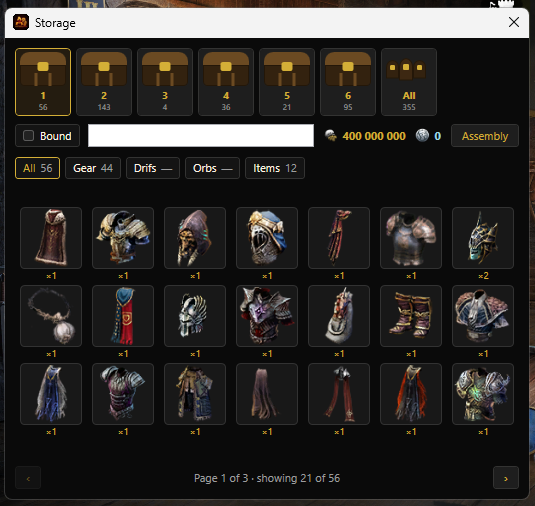
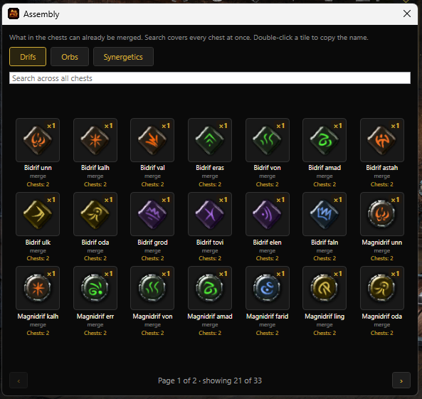
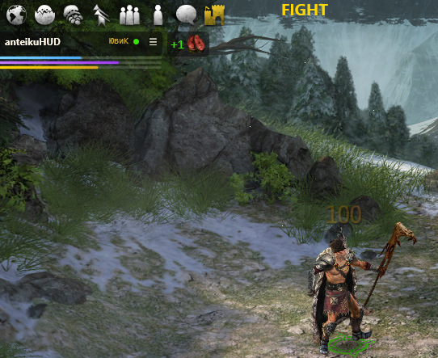
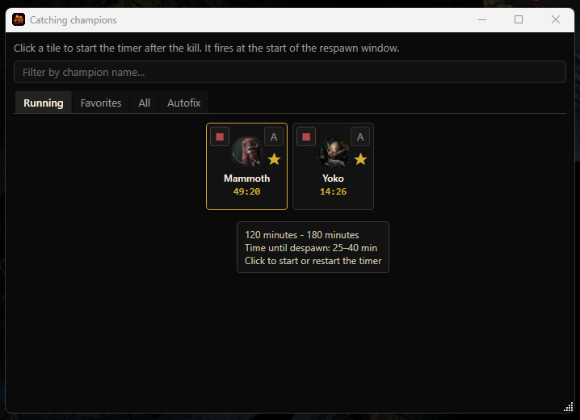
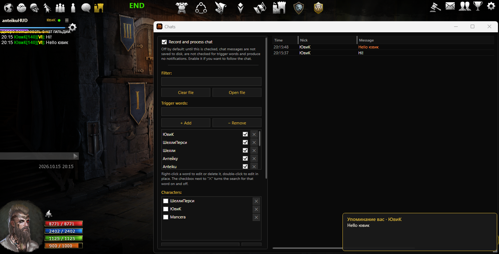
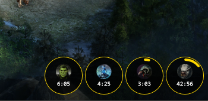

# anteikuHUD — opis funkcji

**Statystyki HUD do gry Broken Ranks**: nakładka na grę, która na żywo pokazuje statystyki farmienia, wydatków, celów i wydarzeń. Wszystkie dane są przechowywane lokalnie w bazie SQLite — historia gromadzi się między uruchomieniami.

[Русский](README.md) · [English](README.en.md) · **Polski**

---

## 1. Przechwytywanie i połączenie z grą

- **Odczyt pakietów sieciowych** przez Npcap — program widzi wydarzenia gry w czasie rzeczywistym (walki, łupy itd.).
- **Wybór urządzenia przechwytywania** (menu „Urządzenie przechwytywania…") — jeśli ruch idzie przez VPN lub inną kartę sieciową, można wskazać właściwe; adaptery VPN są oznaczone odznaką na liście.
- **Zmiana urządzenia przechwytywania** — program poprawnie się restartuje.
- Do przechwytywania pakietów wymagane jest uruchomienie **jako administrator** (przy pierwszym uruchomieniu — obowiązkowo).

## 2. Główne okno HUD

- **Statystyki sesji i walk na żywo** — odłamki, psycho-doswiadczenie, złoto, esencje.
- **Łupy** — śledzenie upuszczonych przedmiotów z wyliczeniem wartości (w tym z bonusem inhibitora +30%).
- **Linia „Wydatki"** — wydatki sesji (zakupy, opłaty za wejście, operacje NPC).
- **Licznik rzadkich przedmiotów** — „moje/cudze" rare'y, sety, epiki.
- **Serie rare'ów** — statystyki serii wypadnięć.
- **Dźwięk przy wypadnięciu rare'a** — osobne pliki dźwiękowe dla własnego dropu i dropu drużyny, regulacja głośności; przycisk „Odtwórz (test)" w menu „Dźwięk rare'a" pozwala sprawdzić wybrany plik mp3 przy aktualnej głośności bez czekania na rare'a.
- **Ranking lokacji** — odłamki/psycho/złoto na godzinę dla instancji.
- **Cele z paskami postępu** — cele na odłamki/psycho/złoto z postępem; ustawienie celu — prawym przyciskiem myszy na linii „Ranking" w głównym oknie.
- **Ustawienia wyświetlania** okna głównego: czcionki i rozmiary, przezroczystość, kolory, kolejność wierszy.
- **Skróty klawiszowe:**
  - `Ctrl+F2` — ukryj/pokaż HUD;
  - `Ctrl+F3` — ukryj/pokaż timery wydarzeń (pojawiają się automatycznie 15 minut przed startem, nawet gdy ukryte).
- **Wyświetlanie HUD:** nakładka może być widoczna **tylko nad aktywnym oknem gry** (ustawiane w ustawieniach); obsługiwane jest automatyczne zwijanie i szybkie rozwijanie.

## 3. Okna statystyk

Dostępne okna z filtrami okresu: **dzisiaj, 24 godziny, 7/30 dni, tydzień gry** (od poniedziałku 00:00) oraz **miesiąc gry** (od 1. dnia 00:00) — według czasu polskiego (serwerowego), a także filtry według postaci.

- **Statystyki** — rare'y, artefakty, serie bez rare'a, serie bez rare'a u bossów.
- **Analiza** — statystyki instancji. Zakładki:
  - **Podsumowanie** — ogólne statystyki instancji;
  - **Wejścia** — co i skąd wypadło w poszczególnych instancjach;
  - **Łącznie** — zdobycz za okresy czasu;
  - **Opłaty za bossów** — faktyczne płatności za wejście do bossów;
  - **Arena** — statystyki areny i opłaty za wejście według poziomów.

## 4. Cele i postęp

- **Paski postępu celów** — osobne okno z paskiem dla każdego celu.
- **Cel na żywo: zestaw pożądanych przedmiotów** — ustaw listę przedmiotów, a HUD podpowie, co już wypadło/zebrano; wybór przedmiotów przez okno wyboru.
- **ETA celu** — oszacowanie czasu do osiągnięcia celu; dla ograniczonych lokacji — termin kalendarzowy; uwzględnia limit szansy na rare'a.
- Cele można ustawiać na odłamki, psycho, złoto i zestaw przedmiotów.

## 5. Depozyt

- **Przeglądarka skrzyń** — zawartość wszystkich skrzyń depozytu z ikonami (odświeżane przy wejściu do Depozytu w grze, każda skrzynia osobno).
- **Widok „Wszystkie depozyty"** — wspólna lista z podświetleniem „Wszystko".
- **Kafelki** przedmiotów z ikonami (ekwipunek — z pól pakietu), numer skrzyni w rogu kafelka, ikony przypiętych orbów, liczba pod numerem skrzyni.
- **Filtry i kategorie** — wyszukiwanie (w tym bez apostrofów), checkbox „Przypięte", złota ramka zaznaczenia, ikony złota i platyny.
- Wyświetlane są także przedmioty poza walką (ikona „+N" przy przychodzących przedmiotach).

## 6. Składanie

- **Okno „Składanie"** — co z zawartości skrzyń można już połączyć (drifty, orby, synergistyczne) według zasad gry: drifty porównywane po rozmiarze, orby grupowane po kategorii poziomu, synergistyczne zbierane po randze.
- **Widok kafelkowy** z nazwami z pakietu, przewijanie stronami.
- Zakładka „Synergistyczne" — informacja o składzie według rang.

## 7. Ulubione i powiadomienia

- **Ulubione** — zaznaczaj cenne przedmioty, orby i drifty, ekwipunek do wizualnego powiadamiania przy zdobyciu.
- **Wyskakujące powiadomienia** — ikony zdobyczy/wydatków pojawiają się po prawej stronie nagłówka HUD na przezroczystym tle; rozmiar ikony, przezroczystość i czas wyświetlania są konfigurowalne.

## 8. Łowienie czempionów (tracker respawnu)

- **Katalog czempionów** — wszystkie czempiony Broken Ranks z czasem odrodzenia, pogrupowane
  według lokacji; okno ma trzy zakładki: **„Uruchomione"**, **„Ulubione"** i **„Wszystkie"**.
- **Timery respawnu** — kliknięcie kafelka uruchamia odliczanie do odrodzenia czempiona.
  Odliczanie korzysta z czasu z katalogu (dla czempionów z zakresem — od minimalnego).
- **Zakładka „Uruchomione"** — tylko żywe timery: zarówno te wciąż odliczające do respawnu,
  jak i te, których respawn już nastąpił (zielone okno). Lista odświeża się sama w miarę upływu czasu.
- **Zielone okno respawnu** — gdy odliczanie osiągnie zero, kafelek przechodzi w zielony licznik
  „RESPAWN M:SS": respawn jest już możliwy i trwa tyle (różnica między czasem minimalnym
  a maksymalnym). Gdy okno się zamyka, timer się zeruje.
- **Ostrzeżenie „wkrótce respawn"** — 5 minut przed odrodzeniem czempiona.
- **Ikony na pasku powiadomień przy HUD** — gotowość czempiona pokazana jako ikona obok
  głównego okna; kliknięcie ikony otwiera okno trackera.
- **Ulubione** — gwiazdka ★ na kafelku dodaje czempiona do ulubionych; gdy taki czempion
  zostanie zabity, wyświetla się dymek „Uruchomić timer?" — timer startuje jednym kliknięciem.
- **Podwojone czempiony** — Grobowiec i Niksoflor żyją w lokacji jako dwie kopie: każda dostaje
  dwa kafelki z osobnymi timerami.
- **Podpowiedź kafelka** — czas respawnu i wskazówka, jak długo czempion czeka przed zniknięciem.
- **Wiele monitorów** — timery i ikony działają poprawnie przy dowolnym położeniu HUD.

## 9. Czat

- **Śledzenie czatu w grze** — okno „Czaty" (menu „Czaty") zapisuje wiadomości gry w czasie
  rzeczywistym, szuka słów kluczowych i pokazuje powiadomienia.
- **Główny przełącznik** — „Nagrywaj i przetwarzaj czat"; czat jest domyślnie **wyłączony**.
  Gdy pole nie jest zaznaczone, wiadomości nie są zapisywane, nie są sprawdzane pod kątem
  słów-triggerów i nie dają powiadomień. Stan jest zapamiętywany między uruchomieniami.
- **Dziennik wiadomości** — tabela „Czas · Nick · Wiadomość", najnowsze na górze; wzmianka
  o twoim nicku jest podświetlona na złoto, uruchomiony trigger — na pomarańczowo.
  Automatyczne przewijanie, wyszukiwanie po nicku/tekście, kopiowanie prawym przyciskiem
  (nick / wiadomość / wszystko), czyszczenie pliku i otwieranie dziennika w edytorze.
- **Filtr postaci** — pokazuj tylko zaznaczone; **ignorowanie** — ukryj wybrane z dziennika
  i wycisz ich powiadomienia (wiadomości nadal trafiają do pliku).
- **Słowa-triggery** — lista słów kluczowych, przy których pojawia się powiadomienie:
  dodawanie, edycja w miejscu (podwójne kliknięcie), usuwanie oraz **pole wyboru
  włączenia/wyłączenia słowa** — odznaczone tymczasowo wyłącza szukanie, słowo pozostaje
  na liście i jest przygaszone.
- **Wyszukiwanie rozmyte** — łapie odmiany i literówki: pierwsza litera musi się zgadzać,
  dokładne wystąpienie od początku słowa, w przeciwnym razie dopuszczalne 1–2 literówki
  (słowa krótsze niż 4 litery — tylko dokładnie; triggery zaczynające się od znaku
  niebędącego literą — dokładne wystąpienie). Kombinacja słów działa, gdy wszystkie słowa
  są w wiadomości w dowolnej kolejności.
- **Powiadomienia** — wyskakujący toast w prawym dolnym rogu (7 sekund) i „przyklejona"
  odznaka nieprzeczytanych z licznikiem na pasku powiadomień, dopóki okno „Czaty" nie
  zostanie otwarte.
- **Plik dziennika** — `chat_log.txt` obok programu, UTF-8 bez BOM; w pamięci ostatnie
  3000 wiadomości, w pliku — wszystkie (pole „Cała historia" czyta plik za wszystkie dni).
- **Lokalizacja** — rosyjski, angielski, polski.

## 10. Wydarzenia

- **Wybór wydarzeń** — które pokazywać; wymaga otwarcia mapy w grze.
- **Timery wydarzeń** — okrągłe timery na ekranie (pojawiają się 15 minut przed startem, automatyczne przedłużanie dla Jastrząb/Wendigo).
- **Wyświetlanie** — standardowe: tekstem; eksperymentalne: okrągłe ikony z wizualnym odliczaniem timera jak na mapie w grze.
- **Przypięcie do krawędzi ekranu** i lustrzany układ (dla wielu monitorów); rozmiar kółek jest zapamiętywany.

## 11. Dane i import

- **Import z BrokenHud** — przeniesienie sesji z zewnętrznego programu.
- **Import naszej bazy** i okno **„Połącz postaci"** — scalenie statystyk postaci.

## 12. Interfejs i języki

- **Języki**: rosyjski, angielski, polski (zmiana języka — z ponownym uruchomieniem).
- **Motyw okien** — ciemno-złote menu kontekstowe, jednolite style list i pasków przewijania.
- **Ustawienia wyświetlania** — czcionka i rozmiary tekstu, przezroczystość okien, wyświetlanie przedmiotów, ustawienia rozbijania/topienia.
- Linki do przydatnych zasobów w menu głównym.

---

## Wymagania systemowe

- **Windows 10/11**
- **Npcap** (sterownik przechwytywania pakietów sieciowych) — pobierz z [npcap.com](https://npcap.com/)
- .NET nie jest wymagany — runtime jest wbudowany w instalator

## Instalacja i uruchomienie

1. Pobierz `anteikuHUD_setup.exe` ze strony **Releases**.
2. Uruchom instalator (instalacja do folderu użytkownika, bez uprawnień administratora).
3. Uruchom anteikuHUD i, w razie potrzeby, prawy przycisk myszy → „Uruchom jako administrator".
4. Po uruchomieniu HUD uruchom grę **Broken Ranks** i zaloguj się na postać.

## Status

Projekt jest w fazie aktywnego rozwoju. Możliwe są zmiany i drobne nieścisłości.
Kod źródłowy nie jest publikowany.
